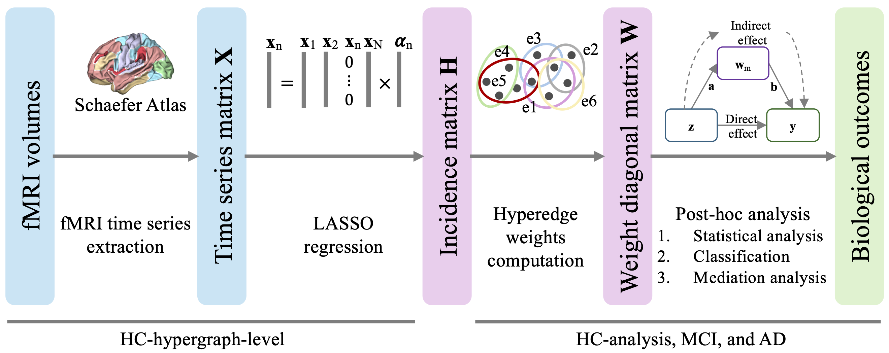

# Algebraic Connectivity Reveals Modulated High-Order Functional Networks in Alzheimer’s Disease

The aims of this projects are threefold:
  - to derive hyperedge weights employing the algebraic connectivity measure in individuals across the Alzheimer’s disease continuum (HC, MCI, AD), based on a shared hypergraph structure
  - to assess its effectiveness in differentiating diagnostic groups in relation to high-order FC patterns through statistical analyses and machine learning binary classification tasks
  - to examine whether hyperedge weights derived from algebraic connectivity mediate the relationship between tau burden and cognitive decline

---

## Pipeline

<p align="center">
  
</p>


---

## Abstract

Functional MRI is a neuroimaging technique that analyzes the functional activity of the brain by measuring blood-oxygen-level-dependent signals throughout the brain. The derived functional features can be used for investigating brain alterations in neurological and psychiatric disorders. In this work, we employed a hypergraph to model high-order functional relations across brain regions, introducing algebraic connectivity ($a(\mathcal{G})$) for estimating the hyperedge weights.
The hypergraph structure was derived from healthy controls to build a common topology across individuals. The considered cohort for subsequent analyses included subjects covering the Alzheimer’s disease (AD) continuum, encompassing both mild cognitive impairment and AD patients. Statistical analysis and three classification tasks: HC vs AD, MCI vs AD, and HC vs MCI, were performed to assess differences across the three groups and the potential of the hyperedge weights as functional features.
Furthermore, a mediation analysis was performed to evaluate the reliability of the $a(\mathcal{G})$ values, representing functional information as the mediator between tau-PET levels, a key biomarker of AD, and cognitive scores. 
The proposed approach identified a larger number of hyperedges statistically different across groups compared to state-of-the-art methods. 
The $a(\mathcal{G})$ hyperedge weights also demonstrated a higher discriminative power in all three binary classifications.
Finally, two hyperedges belonging to salience/ventral attention and somatomotor networks showed a partial mediation effect between the tau biomarker and cognitive decline. These results suggested that $a(\mathcal{G})$ can be an effective approach for extracting the hyperedge weights, including important functional information that resides in the brain areas forming the hyperedges.

---

## How to use

### Data

The dataset is loaded in the main.py (or main.ipynb) script using pickle. The dictionary have to contain the following keys and corresponding data:
 - fmri: the value is a numpy array containing the fMRI time series of each subject in the cohort. A 3D numpy array of shape [num_subjs x P x N], where num_subjs is equal to the number of subjects, P is the time series length, and N is the number of brain regions
 - demos: a pandas DataFrame containing all the information for each subject, such as demographic, cognitive scores, and subject labels
 - labels: a list/array of labels for each subject (HC, MCI, Dementia)

The order of the subjects in the 'labels', 'fmri', and 'demos' must be the same.

### Scripts

The main.py script runs the full analysis pipeline, which includes:
 - Computing the hypergraph structure
 - Extracting hyperedge weights
 - Performing statistical group analyses and pairwise post-hoc tests
 - Running three binary classification tasks
 - Conducting the mediation analysis

An interactive Python notebook, main.ipynb, is also provided to run the analyses step-by-step and examine the results iteratively.

The files posthoc_statistical_analysis.py, posthoc_classification.py, and posthoc_mediation_analysis.py each contain a dedicated function for performing statistical analysis, classification, and mediation analysis, respectively. These functions are invoked within main.py.

The Utils/ folder contains additional helper scripts with supporting functions used throughout the analysis.

---

## Citation

```
@article{dolci2025algebraic,
  title={Algebraic Connectivity Reveals Modulated High-Order Functional Networks in Alzheimer’s Disease},
  author={Dolci, Giorgio and Saglia, Silvia and Brusini, Lorenza and Calhoun, Vince D and Boscolo Galazzo, Ilaria and Menegaz, Gloria},
  journal={arXiv preprint arXiv:2508.01252},
  year={2025}
}
```
